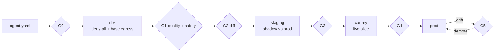

# agent-promotion-lab

**Promote AI agents from a sandbox to production through evidence gates. One policy, compiled to
NVIDIA OpenShell and CNCF Agent Substrate.**

An agent version is more than an image: it is the image plus the model, prompt, tools, data class
and what it may reach. This repo treats that whole bundle as the unit of release and moves it
**sbx → staging → canary → prod** only when each gate has evidence:

| Gate | Evidence | First green run (kind, real OpenShell sandboxes) |
|---|---|---|
| G0 build | manifest, model allow-list, exact external hosts, no shell, data class per zone, digest pinning | PASS |
| G1 quality | 10 cases × 3 repeats, ground truth fetched outside the sandbox, Wilson lower bound | 30/30, lower bound 88.6% |
| G1 safety | agent cases under the compiled policy + the 18-case hostile-agent suite | 2/2 (publish stopped in-sandbox: `Permission denied`) + 18/18 |
| G2 policy diff | anything the agent can now reach that it could not before | no widening |
| G3 shadow | 12 recorded prod requests replayed through candidate vs current prod | win 12 / tie 0 / loss 0, p95 340-473 ms |
| G4 canary | 40 live requests, error budget 5%; platform failures counted separately | 40/40 answered, 0 errors → promote |

Whole flow on kind, sbx to prod: **211 s** after the platform is up ([run](https://github.com/sai337/agent-promotion-lab/actions/runs/45312333122)).



## Quick start

```bash
pip install -e '.[test]' && pytest -q                    # 29 tests, no cluster
agentctl validate examples/package-advisor/agent.yaml --zone sbx
agentctl compile  examples/package-advisor/agent.yaml --zone prod --runtime openshell
agentctl compile  examples/package-advisor/agent.yaml --zone prod --runtime substrate   # prints fidelity warnings
bash e2e/promote-kind.sh                                 # full sbx -> prod run on kind (Docker, kind, helm)
```

## What is new here

1. **The bundle is the release.** A fingerprint over the whole `agent.yaml` ties every piece of
   evidence to one exact version; change the prompt or model and the evidence goes stale.
2. **Statistical quality gates.** Pass rate *and* a 95% lower bound, so 6/6 cannot promote anything.
3. **Runtime-security evidence as a gate.** The hostile-agent suite from openshell-eks-lab is part of G1.
4. **One policy, two runtimes, honest about the gap.** The compiler emits OpenShell (host, binary,
   HTTP method) and Substrate (hostnames) policies, and warns about every rule Substrate cannot express.
5. **Promotion is a PR.** `agentctl promote` only edits `envs/<zone>/releases.yaml`; review and
   merge is the deploy, revert is the rollback.

## Docs

| Doc | |
|---|---|
| [docs/PROMOTION.md](docs/PROMOTION.md) | zones, gates, evidence, PR flow, app vs agent SDLC |
| [docs/DEPLOYMENT.md](docs/DEPLOYMENT.md) | local, kind, EKS (with openshell-eks-lab's cluster), Substrate as prod runtime |
| [docs/EVALS.md](docs/EVALS.md) | quality, safety, shadow and canary cases with pass rules |
| [docs/ARCHITECTURE.md](docs/ARCHITECTURE.md) · [THREAT-MODEL](docs/THREAT-MODEL.md) | design and what the pipeline defends against |
| [article/](article) | the write-up, LinkedIn copy, images |
| [.kiro/steering/project.md](.kiro/steering/project.md) | rules and done-criteria for an agent running this |

Companion repos: [openshell-eks-lab](https://github.com/sai337/openshell-eks-lab) (runtime + 18-case
suite) and [agent-substrate-lab](https://github.com/sai337/agent-substrate-lab) (stateful fleets).

## Scorecard (honest)

| Dimension | Score | Evidence | What closes the gap |
|---|---|---|---|
| Bundle, G0, compiler, G2 | 10 | 29 unit tests; CI compiles every zone for both runtimes and lints the OpenShell output with openshell-eks-lab's linter | - |
| G1-G4 end to end | 9 | `promote-kind` green in real sandboxes | run on EKS with a pinned ECR digest |
| G5 drift | 6 | gate logic + tests | a scheduled re-eval feeding history |
| Substrate as prod runtime | 6 | compiler + warnings; runtime proven in agent-substrate-lab | an end-to-end promote onto Substrate |
| Evidence integrity | 6 | fingerprints, CI-produced | sign evidence and images (cosign) |

## Licence

Apache-2.0
