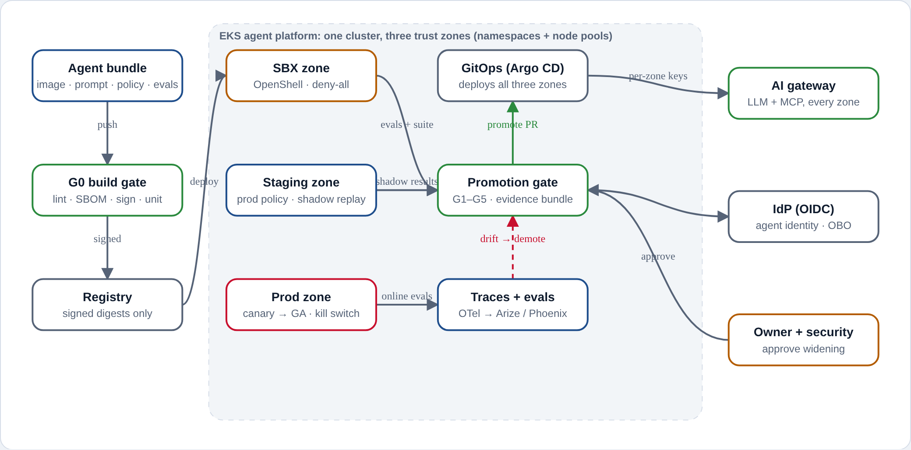
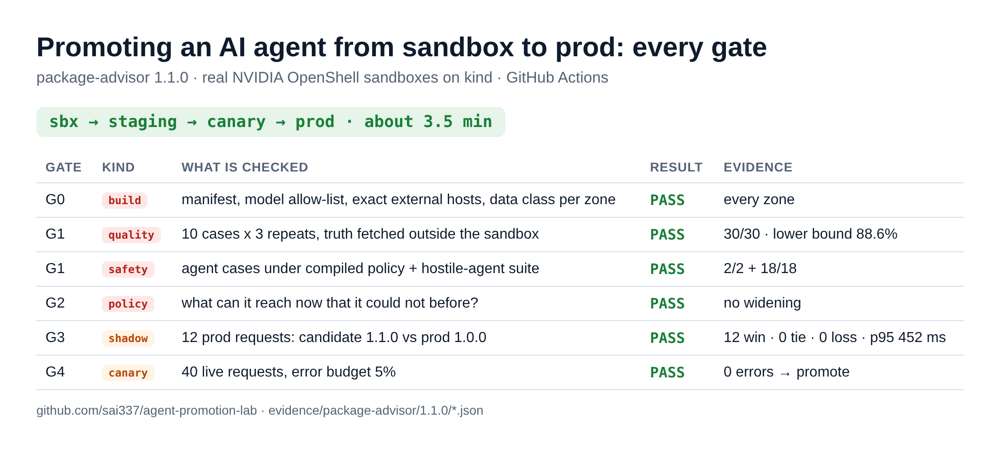

# Agents don't go from sandbox to prod. They earn their way there.

The question I keep hearing from platform teams: "we have agents working in a sandbox; how do we get
them to production?" Most answers stop at "add evals to CI". That is necessary and nowhere near
enough. An agent's release is not its image. It is the image **plus** the model, the prompt, the
tools, the data it touches and everything it is allowed to reach. Any of those can change without a
line of code changing.

So I built the pipeline I wanted: an agent is promoted from **sandbox → staging → canary → production**
only when each step has evidence, and it runs end to end on Kubernetes with the agent inside real
NVIDIA OpenShell sandboxes.

**TL;DR**
- The unit of release is an `agent.yaml` bundle. A fingerprint over the whole file ties all evidence to
  one exact version: change the prompt and you re-earn the promotion.
- Six gates: build checks, quality evals with a statistical bound, safety (including an 18-attack
  hostile-agent suite), a policy diff, shadow replay against the current prod version, and a canary.
- One policy compiles to OpenShell **and** CNCF Agent Substrate, with a warning for every rule the
  second runtime cannot express.
- First green run on kind: every gate passed and the agent went from sandbox to prod in about 3.5 minutes.
- Open source: https://github.com/sai337/agent-promotion-lab



## Why "sandbox straight to prod" is wrong

A sandbox answers one question: *is this agent safe to run?* It does not answer: is it **better** than
what users have today, on **their** traffic, at acceptable cost, and does it **stay** that way. Those need
different environments and different evidence:

| Zone | Proves | Permissions |
|---|---|---|
| sbx | safe, and works on its eval set | deny-all plus declared hosts, no real credentials |
| staging | better than prod on replayed real traffic | the prod policy |
| canary | holds on a live slice | prod, small traffic |
| prod | keeps proving it (drift check) | changed only through the policy-diff gate |

## The bundle

```yaml
metadata: {name: package-advisor, version: 1.1.0, owner: sai337}
spec:
  image: <registry>/package-advisor@sha256:...
  model: none                      # or a model on the platform allow-list
  prompt: prompts/advisor@v2
  tools: []
  dataClass: public
  runtime: {sbx: openshell, staging: openshell, canary: openshell, prod: openshell}
  policy:
    program: /usr/local/bin/python3.13       # the only binary allowed on the network
    egress: [{host: pypi.org, access: read-only}]
    zones: {sbx: [], staging: [], canary: [], prod: []}   # each zone may only add
  evals: {quality: {repeats: 3, minPassRate: 0.95, minLowerBound: 0.85}}
```

The demo agent is deliberately small and real: it answers questions about Python packages from the
PyPI API. Version 1.0.0 (in prod) returns the latest version; 1.1.0 (the candidate) also returns the
supported Python versions and the licence.

## The gates

**G0, build.** Owner present, model on the allow-list, the network program is not a shell, every host
is an exact external name (no wildcards, no cloud metadata, no cluster addresses), only read-only or
read-write access, the data class is allowed in the target zone (no confidential data in a sandbox),
and the image is pinned by digest from staging on.

**G1, quality.** 10 cases × 3 repeats. The ground truth is fetched by the *runner*, outside the sandbox,
so the agent never grades its own homework. The gate needs a 95% pass rate **and** a 95% Wilson lower
bound of at least 85%. That second number matters: 6 out of 6 has a lower bound of 61%. A lucky small
run cannot promote anything.

**G1, safety.** The agent's own risky actions under the compiled policy (it tries to publish to PyPI; it
gets a path-traversal name) plus the 18-case hostile-agent suite from my OpenShell lab. A "blocked"
result only counts if the policy stopped it, not if PyPI said no.

**G2, policy diff.** Compare what the agent can reach in the target zone with what is approved in prod:
new hosts, read-only to read-write, a different program, new writable paths, a new model, new tools, a
different data class. Any widening needs a named approver on the promotion PR.

**G3, shadow.** Replay recorded production requests through the candidate and the current prod version;
score each answer by how many facts it gets right. Gate: win-or-tie ≥ 90% and p95 latency within budget.

**G4, canary.** Live requests to a canary; error rate within budget, otherwise the decision is rollback.

**G5, drift.** Re-evaluate in production; if quality drops more than 5 points, demote to the last good version.

## Promotion is a pull request

`agentctl promote` refuses unless every gate the zone requires has passed for the **same fingerprint**,
and then it only edits `envs/<zone>/releases.yaml`: version, previous version, image, runtime, policy
hash, evidence path, owner. Review and merge is the deploy; revert is the rollback.

## One policy, two runtimes

I run two agent runtimes in my labs. NVIDIA OpenShell governs each call (host, program, HTTP method).
CNCF Agent Substrate packs many stateful agents onto few pods (in my tests: 4 per worker, resume p95
under 215 ms). The bundle declares the policy once; the compiler emits both. For Substrate it prints
warnings like:

> pypi.org: 'read-only' cannot be enforced per HTTP method in a Substrate EgressPolicy; the host is
> allowed for all methods.

That warning is the point. It turns "which runtime?" into a visible design decision: agents whose
safety depends on method limits stay on OpenShell.

## Results (first green run, kind in GitHub Actions)



| Gate | Result |
|---|---|
| G0 | pass at every zone |
| G1 quality | 30/30, lower bound 88.6% |
| G1 safety | 2/2 agent cases + 18/18 hostile-agent suite |
| G2 | no widening between 1.0.0 in prod and 1.1.0 |
| G3 | 12 wins, 0 ties, 0 losses vs prod; candidate p95 340-473 ms across runs |
| G4 | 40 canary requests, 0 errors → promote |
| Whole flow, sbx to prod | about 3.5 minutes (211 s) after the platform is up |

## Two lessons from the runs that failed

**A "blocked" result has to be proven.** My first safety check passed if the agent's attempt to publish
to PyPI failed. But it could fail because PyPI rejected it, which proves nothing about the sandbox. The
check now requires that the upstream never answered. The evidence shows exactly that: inside the
sandbox the agent got `Permission denied` before any request left.

**A platform failure is not an agent failure.** One run rolled back a perfectly healthy agent: 22 of 40
canary requests "failed". None of them reached the agent. The connection to the sandbox gateway had
degraded during a long run. If your canary cannot tell "the agent got it wrong" from "the request never
arrived", it will roll back good versions and, worse, promote bad ones on a good day. The canary now
counts platform failures separately: they are excluded from the error rate, and too many of them make
the result *inconclusive* (no promotion, no verdict on the agent) instead of a rollback.

**On EKS:** _[update after the EKS run: same flow against the EKS gateway, image pinned by ECR digest,
sandboxes on a tainted node group.]_

## How this differs from shipping an app

| | App | Agent |
|---|---|---|
| Released unit | code + config | code + prompt + model + tools + policy + evals |
| Triggers a release | code change | also model, prompt, tool or policy change |
| Tests | deterministic | repeated, with a statistical bound, plus attacks |
| Lowest environment | trusted dev | untrusted sandbox |
| Between environments | endpoints change | permissions widen, gate by gate, in a diff |
| Rollback | previous image | previous bundle; memory reset; kill switch |

## Try it

```bash
git clone https://github.com/sai337/agent-promotion-lab && cd agent-promotion-lab
pip install -e '.[test]' && pytest -q
bash e2e/promote-kind.sh
```

Companion repos: the OpenShell runtime and its 18-case suite
(https://github.com/sai337/openshell-eks-lab) and the Substrate measurements
(https://github.com/sai337/agent-substrate-lab).
