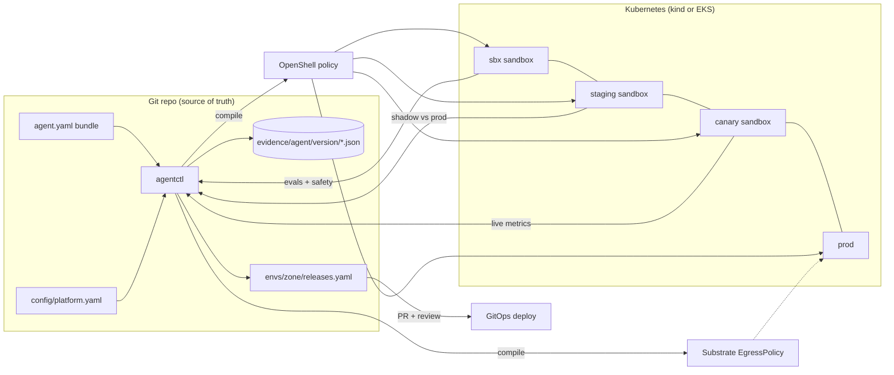

# Architecture

| Component | Role |
|---|---|
| `agent.yaml` | the bundle: image, model, prompt, tools, data class, runtime per zone, one policy, evals, shadow and canary budgets |
| `config/platform.yaml` | platform rules: zones, runtimes, model allow-list, data classes per zone, gates required per zone, digest pinning |
| `agentctl` | validates, compiles policies, runs evals inside sandboxes, records evidence, promotes |
| `evidence/` | one JSON per gate per bundle version, tied to the bundle fingerprint |
| `envs/<zone>/releases.yaml` | desired state per zone; changed only by `agentctl promote` through a PR |
| openshell-eks-lab | runtime + 18-case suite used for G1-safety and to run the sandboxes |
| agent-substrate-lab | runtime for prod fleets of stateful agents; consumes the compiled EgressPolicy |

The runner fetches ground truth itself, outside the sandbox, so the agent cannot grade its own work.
